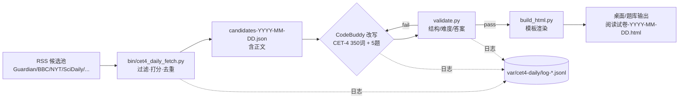

# CET-4 每日模拟题管线

## 现状 v2（2026-11-04，以此为准；下面 v1 章节仅存档）

**硬规则（不可违背）**

1. **不设脚本通过门**。脚本只拼证据、跑流程；通过与否只看独立审查老师的 `verdict`。
2. **写手与审查永远是两个独立 CB 会话**，禁止自审；自审产物只能算草稿。
3. **审查的 `must_fix` 必须回灌给 repair 会话**。只重跑 writer 等于同一篇文章重掷骰子（实测：74→62→78 抖动，回灌后 80→pass 90）。
4. 正文与题目分开迭代：正文定稿后用 `--qonly` 只改题，避免"改题顺手改正文"互相拉扯（实测：同一篇 70→60→70 抖动，冻结正文后一次 pass 94）。
5. 数据诚实：无官方答案的题标 `cb-recommended`；ASR 转写不是官方文本；来源缺失就写缺失，不许编。

**链路 v2**

```
fetch(RSS) → candidate_input(清正文/去噪) → adapt(writer: 改写+段析) → reviewer
   ↑                                                              ↓ needs_revision
   └──────────── repair(must_fix 回灌) ←──────────────────────────┘
        ↓ pass
swap_section(换入整卷, 第二篇自动重编号 51-55)
        ↓
listen/writing/cloze/match explain(讲解内容) → build_paper(plain|explain)
        ↓
review_paper(整卷 3 票, 多数决) → 发布
```

**关键脚本**

| 用途 | 脚本 |
|---|---|
| 选材 | `bin/cet4_daily_fetch.py`（HTMLParser 正文提取，BBC 这类页面不再混入标签） |
| 候选→输入 | `bin/cet4_candidate_input.py <idx> <out.json>` |
| 出题/审查/修复 | `bin/cet4_roles.py --type ... --role writer|reviewer|repair [--qonly]` |
| 修复循环 | `bin/cet4_pipeline.py --type ... --input ... --rounds N [--resume] [--qonly]` |
| 换入整卷 | `bin/cet4_swap_section.py --paper ... --section ... --from ...` |
| 讲解内容 | `cet4_listen_explain.py` / `cet4_writing_explain.py` / `cet4_cloze_explain.py` / `cet4_match_explain.py` |
| 渲染 | `bin/cet4_build_paper.py <paper.json> --mode plain|explain` |
| 整卷审查 | `bin/cet4_review_paper.py <paper.json> --voters 3` |
| 装配自检（证据，非门） | `bin/cet4_paper_audit.py` |

**真题基准（21 套实测，2026-11-04 重算）**

| 板块 | 实测 |
|---|---|
| Section C 正文 | 348–375 词（中位 358），每篇 5 题 |
| Section B | 10–15 段（中位 12–13），段落正文均 1015 词，10 条陈述，2–5 段冗余 |
| 选词填空 | 188–316 词（均值 243），15 词库选 10 |
| 翻译 | 138–159 汉字，3–6 句 |
| 写作 | 情景观点式，120–180 词 |

> 旧文档写的 "10–11 段"（Section B）与 "188–267 词"（选词）都是提取正则只认到 K) 造成的错误基准，已修 `bin/cet4_full_extract.py` 并重算 KB。

**已知缺口（未完成，标注 PARTIAL）**

- 每日定时任务尚未挂上（需 Windows 任务计划调用 `cet4_daily_fetch.py` → 管线）。
- 听力 8 段音频仍是设计样本，尚未按日从候选文章生成；听力脚本无独立审查通过记录。
- 一整套 57 题的全自动日产能未验证（当前是分题型独立跑完再装配）。

**已修的坑：音频跳句失效（2026-11-04）**

现象：点字幕某句，音频从 0 重新播。根因：`<audio src=...>` 走 HTTP 时，若服务端不支持 `Range` 请求，浏览器无法定位，`currentTime` 赋值被静默忽略（实测 `seeking` 变 true 后又归 0；同一文件用 Blob 载入可精确跳到 21.789s）。
修法：`upgradeAudio()` 先把 mp3 fetch 成 Blob 再挂给播放器（Blob 支持随机访问）；file:// 下 fetch 被拦则退回原生 src。另加：点句单句模式（到下一句起点自动停）、`连播` 开关、跨段自动暂停其它音频。

---

# 设计稿 v1（存档）

> 目标：每天自动产出一篇「CET-4 仔细阅读风格」模拟题（350±60 词 + 5 题 + 解析 + 双语逐句），并生成可直接做题的 HTML。
> 现状：选材脚本已实现（`bin/cet4_daily_fetch.py`，本次实跑通过）；改写与出题由 CodeBuddy 承担；HTML 生成待接模板。

## 一、链路



## 二、阶段与产物

| 阶段 | 脚本/角色 | 输入 | 输出 | 失败处理 |
| :--- | :--- | :--- | :--- | :--- |
| 1 选材 | `bin/cet4_daily_fetch.py` | 12 个 RSS | `var/cet4-daily/candidates-*.json` + JSONL 日志 | 单源失败记 `feed_fail`，不中断 |
| 2 改写出题 | CodeBuddy（默认 `deepseek-v4.1-flash`） | 候选正文 | 结构化 JSON（见下） | 重试 2 次，仍失败换下一篇候选 |
| 3 校验 | `bin/cet4_daily_validate.py`（待写） | 改写 JSON | pass / 具体错误 | 回传给 CB 定向修复 |
| 4 渲染 | `bin/cet4_daily_build.py`（待写） | 校验通过 JSON | 单文件 HTML（沿用 v11 交互） | 失败保留 JSON |
| 5 归档 | 定时任务 | 全部产物 | `knowledge/cet4-bank/10-每日模拟题/` | — |

## 三、CodeBuddy 改写契约（必须逐字遵守）

```text
你是大学英语四级命题组的阅读选材编辑。输入是一篇英文文章（含标题、正文）。
请输出严格 JSON（不要 markdown 代码块、不要解释），字段如下：

{
  "title": "改写后英文标题（<=12 词）",
  "title_cn": "中文标题",
  "topic": "教育/职场/心理/健康/环境/科技/消费 之一",
  "passage": "改写后的正文，350±60 词，5-7 段，每段 2-4 句",
  "sentences": [
    {"en": "英文原句（与 passage 完全一致、按顺序）",
     "cn": "整句中文翻译",
     "chunks": [{"en": "意群（5-8 词）", "cn": "该意群中文"}]}
  ],
  "questions": [
    {"no": 1, "stem": "题干（英文，<=20 词）",
     "options": ["A) ...", "B) ...", "C) ...", "D) ..."],
     "answer": "A|B|C|D",
     "evidence": "原文定位句（必须逐字出现在 passage 中）",
     "paraphrase": {"original": "原文词句", "option": "选项换皮词"},
     "trap": "干扰项类型：无中生有/偷换概念/因果倒置/范围扩大/原词拼接"}
  ],
  "difficulty": {"words": 350, "avg_sentence": 19, "long10_pct": 7, "cefr": "B2|C1"}
}

硬约束：
1. 文章必须保留原文的「反常识结论 + 研究/数据证据 + 转折」结构；删掉具体人名机构名中的生僻部分，保留论证。
2. 词汇控制：不出现超出四级大纲的冷僻词（专有名词除外）；≥10 字母单词占比 5%-9%。
3. 句长：平均 17-21 词，单句不超过 35 词。
4. 5 道题：细节 2、推断 1、态度/观点 1、词义/指代 1（可微调，但必须有 1 道转折处推断）。
5. 每题 4 个选项，长度接近；正确答案必须是同义替换，不能照抄原文。
6. evidence 必须是 passage 中逐字存在的句子（用于页面高亮）。
7. 中英逐句：sentences 的 en 按顺序拼起来必须与 passage 完全一致。
```

## 四、校验门禁（`cet4_daily_validate.py` 要检查）

| 检查 | 规则 | 不通过处理 |
| :--- | :--- | :--- |
| JSON 可解析 | 严格 JSON | 重试 |
| 词数 | 320–420 | 回传 CB 扩/删 |
| 句长 | 平均 17–21，最大 ≤ 35 | 回传 |
| 长词比 | 5%–9% | 回传 |
| 题数 | 恰好 5，题号 1–5 | 重试 |
| 选项 | 每题 4 个，A)-D) 前缀，长度差 ≤ 2 倍 | 回传 |
| 答案 | answer ∈ A-D，且 5 题答案不全同 | 重试 |
| 定位 | evidence 能在 passage 中逐字找到 | 回传 |
| 逐句 | sentences 拼接 == passage | 回传 |
| 去重 | 与历史题目 title/首段相似度 < 0.8 | 换文 |

## 五、调度

- **选材**：每天 06:30 抓一次（RSS 更新足够）；每周日多抓一批做候选池。
- **实现**：Windows 任务计划程序 `CET4-Daily-Mock`，调用
  `pwsh -File bin/cet4_daily_run.ps1`（待写，串起 fetch → codebuddy → validate → build）。
- **为什么不用 DSH 定时**：DSH 的定时器需要宿主在线；系统级任务计划更稳。
- 夜间重跑失败自动重试 1 次；连续 2 天失败写 `var/cet4-daily/ALERT.txt`。

## 六、日志（用户要求：可 grep、能还原因果链）

JSONL 每行：

```json
{"ts":"2026-11-03T20:55:00+08:00","stage":"fetch","source":"The Guardian","status":"accept","title":"...","url":"...","words":812,"score":9,"hits":["education","brain"]}
{"ts":"...","stage":"adapt","model":"deepseek-v4.1-flash","status":"pass","words":356,"questions":5,"latency_s":74}
{"ts":"...","stage":"validate","status":"fail","reason":"evidence_not_found","q":3}
```

记录「为什么没动作」：`skip_len` / `skip_topic` / `skip_dup` / `article_fail` / `feed_fail`。

## 七、目录

```
var/cet4-daily/                  # 运行产物（不入库）
  candidates-YYYY-MM-DD.json
  adapted-YYYY-MM-DD.json
  log-YYYY-MM.jsonl
  state.json
knowledge/cet4-bank/10-每日模拟题/   # 成品归档（入库）
  YYYY-MM/cet4-mock-YYYY-MM-DD.md
  YYYY-MM/cet4-mock-YYYY-MM-DD.html
```

## 八、已知风险

1. **版权**：改写是衍生作品，个人学习可；入库/公开需谨慎（与 08 音频同性质）。
2. **CB 质量波动**：默认 flash 模型写 350 词+5 题偶有跑题；校验门禁必须硬卡，不能放行。
3. **付费墙**：NYT/Economist 正文拿不全 → 只用 RSS 摘要的文章会被字数过滤掉，属预期行为。
4. **长尾来源**：34% 真题来自垂类站，但它们没有稳定 RSS；暂以人工补充，不强求自动化。
